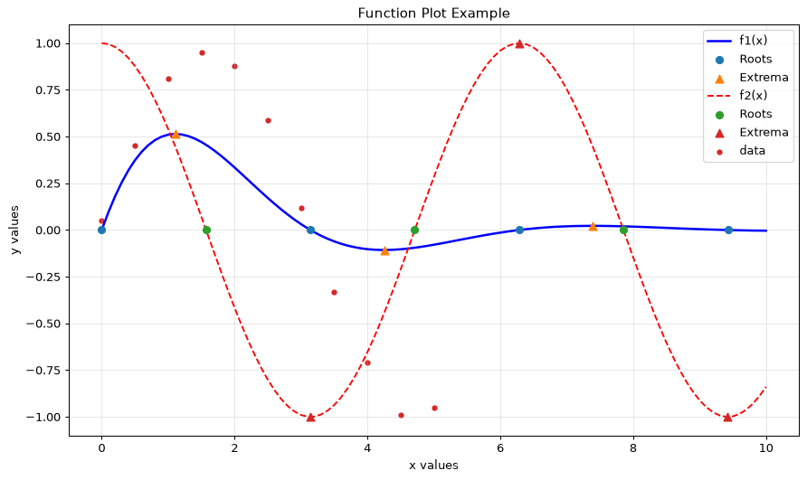
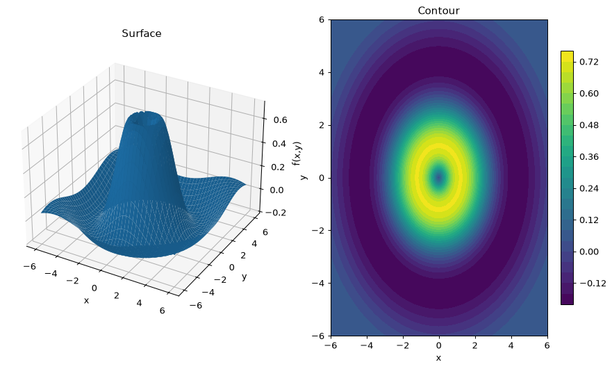

[Deutsch](README.md) | **English**

# Function plotter – Python, Tkinter and Matplotlib

A desktop program for plotting mathematical functions, parametric curves, Bode diagrams and 3D surfaces. It can be
used through a Tkinter GUI, or without a GUI from a plain-text configuration file.

Built for the Python course at Hochschule Hannover, winter semester 2025/26.

| Functions, curve analysis and measured data | Bode diagram | 3D surface and contour lines |
|---|---|---|
|  |  |  |

## Features

- **Four plot modes**
  - **2D**: several functions f(x) at once
  - **Parametric**: curves x(t), y(t)
  - **Bode**: magnitude and phase of a transfer function given as numerator and denominator coefficients
  - **3D**: surface and contour plots of f(x, y)
- **Curve analysis**: numerical first and second derivatives, and marked roots, extrema and inflection points
  (roots are refined by linear interpolation)
- **Measured data**: load x/y values from a text file and show them as a line or scatter plot next to the
  functions
- **Customisable styling**: title, axis labels, grid, legend, and colour, line width and line style per function
- **Interactive GUI**: live cursor coordinates, click-to-annotate points, zoom and pan through the Matplotlib
  toolbar, export as an image
- **Save and load configurations** as readable `key: value` files
- **Safe expression evaluation**: expressions only see a whitelist of NumPy functions and constants, with no
  Python built-ins; `^` works as the power operator

## Running it

```bash
pip install numpy matplotlib
python app.py                                 # GUI
python app.py examples/config_bode.txt        # without GUI: plot straight from a configuration file
```

## Configuration format

```text
# Two functions with curve analysis and measured data
functions: [exp(-0.5*x)*sin(x), cos(x)]
xstart: 0
xend: 10
xstep: 0.1
find_roots: True
find_extrema: True
data_file: examples/messwerte.txt
title: Function Plot Example
```

More examples are in [`examples/`](examples/).

## Structure

| File | Role |
|------|------|
| `app.py` | Entry point: GUI, or no-GUI mode when a configuration file is passed |
| `gui.py` | Tkinter interface with controls for each mode and the embedded Matplotlib canvas |
| `plotter.py` | All plotting and the numerical analysis, independent of the GUI |
| `config_parser.py` | Reads `key: value` files and converts the values to booleans, numbers and lists |
| `widgets.py` | A scrollable frame for the long control panel |

## Tech stack

Python · Tkinter · Matplotlib · NumPy
